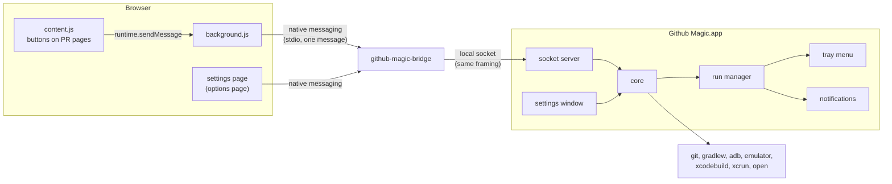

# Desktop app

Plan for replacing the Python native helper (`native-host/open_pr_in_studio.py`) with a desktop app that stays running in the menu bar. The browser still talks to it through native messaging, via a small bridge program inside the app.

## Decisions

| Topic | Decision |
|---|---|
| Who installs it | Anyone, not just the author. macOS builds ship unsigned (ad-hoc signed): users allow the app once under System Settings → Privacy & Security → Open Anyway |
| Stack | [Tauri 2](https://v2.tauri.app): Rust core, native tray menu, plain HTML/JS settings window |
| Platforms | macOS first. Linux and Windows come later, behind one platform module |
| Port | In steps: the app first hands every message to the Python script, then the actions move to Rust one at a time, then the script is deleted |
| Settings | Owned by the app: its `settings.json` is the only copy, so there is nothing to sync. One shared settings page is both the app's Settings window and the extension's options page, and both read and write the app's store. The extension stores none. Each repo has its own app ID (Android) or scheme (iOS) |
| Tray menu (v1) | Current run per device (PR, state, elapsed time) with Cancel and Show log, last result per device, Update, Settings…, Quit |
| Notifications | One per finished run, with a Show log button |
| Install | Homebrew tap (`brew install --cask philippschumann/tap/github-magic`) and a `.dmg` on GitHub releases |
| Updates | In-app: checked at launch and daily, offered as a tray menu item, installed only when clicked |
| Chrome extension | Published unlisted on the Chrome Web Store. The app and the extension exchange a protocol version |
| Settings import | None. Everyone re-enters their settings once |
| Repo | The app lives in `desktop/` in this repo. App and extension share one version number and one release |

Out of scope for v1: worktree cleanup, a PR list, Chromium browsers other than Chrome, Linux, Windows, and Apple signing and notarization.

## How it fits together



A click on "Run on emulator":

1. `content.js` sends `{action: "emulator", repo, pr, branch, title}` to `background.js`, which adds `protocol` and calls `chrome.runtime.sendNativeMessage("github_magic", …)`.
2. The browser starts `github-magic-bridge` (path from the native messaging manifest). The bridge connects to the app's socket, starting the app first if it isn't running, and copies the request frame across.
3. The app validates the request, prepares the worktree, starts the run in the run manager and replies `{ok: true, path, run}`. The bridge writes that reply to stdout and exits.
4. `content.js` polls `{action: "status", run}` every 3 s, as it does today. The tray menu shows the run live, and a notification reports the result.

## Components

### Bridge (`desktop/bridge`)

A small Rust binary, bundled as a Tauri sidecar in `Github Magic.app/Contents/MacOS/github-magic-bridge`. It does nothing but relay bytes:

- It reads one length-prefixed frame from stdin (4-byte native-endian length, then JSON), capped at 1 MB.
- It connects to the app's socket. If the connection fails and the bridge sits inside a `.app`, it runs `open -g -a <bundle>` and retries every 100 ms for up to 10 s. It starts the app through LaunchServices (`open`), not as a child process. Browsers may kill the host's process tree once it has replied, and an app started by launchd gets its own identity for macOS permission prompts.
- It writes the request frame to the socket, reads one reply frame and writes it to stdout.
- If the app can't be reached, it replies `{ok: false, title: "Github Magic isn't running", error: …}` itself.

The bridge never parses JSON, so protocol changes never touch it.

### App (`desktop/app`)

The Tauri app. It runs without a Dock icon (`LSUIElement`) and shows only the tray icon and, when opened, the settings window.

- **Socket server:** a tokio `UnixListener` at `<per-user temp dir>/github-magic.sock`, created with mode `0600`. The per-user temp dir comes from `confstr(_CS_DARWIN_USER_TEMP_DIR)` and is private to the user. A Unix socket path can be at most 104 bytes, and `~/Library/Application Support/<bundle id>/…` can go over that. A stale socket file is removed before `bind`. Each connection is handled in its own task, so a slow `git fetch` never blocks status polls.
- **Single instance:** `tauri-plugin-single-instance`. A second launch opens the settings window.
- **Settings changes:** every write goes through `core::settings`, which broadcasts the change. The app's settings window re-renders on it.
- **Start at login:** `tauri-plugin-autostart`, switched on by default and toggled in Settings.
- **Native messaging registration:** the app writes the browsers' host manifests at every start, so they always point at the running app's bridge (see below). This replaces `install.sh`.
- **Quitting:** if a run is going, the app asks "1 run in progress. Quit and cancel it?" and cancels it on yes. Emulators and simulators keep running. The same check runs before an update restarts the app.

### Core (`desktop/core`)

A library crate with no Tauri dependency, so `cargo test` covers it without a UI. It holds all the logic of today's script:

| Python today | Rust module |
|---|---|
| `main` (framing) | `bridge` binary + `app::server` |
| `handle`, input validation | `core::handler` |
| `run` | `core::cmd` (`Command` with arguments, never a shell) |
| `worktree_for_branch`, `ensure_worktree`, `branch_deleted`, `update`, branch name check | `core::git` |
| `xcode_project`, `avds`, `simulators`, `detect` | `core::detect` |
| `find_app`, `installed_ides`, `IDES`, `IOS_IDES`, `APP_DIRS`, PATH prefix, `java_home` | `core::platform::macos` |
| `open_claude` | `core::claude` |
| `current_run`, `cancel_previous`, `start_launch`, `run_status`, `launch_main`, `on_cancel` | `core::runs` (run manager) |
| `sdk_dir`, `phone_serial`, `avd_serial`, `emulator_ready`, `wait_for`, `emulator_serial`, `gradle_install`, Android `launch` | `core::android` |
| `iphone_udid`, `ios_launch` | `core::ios` |
| `worktree_dir`, `config.py` | `core::settings` |
| `choose_folder` | app, through `tauri-plugin-dialog` (native folder picker) |
| `notify` | app, notifications |

Changes from the script:

- **Launcher activity:** `START_ACTIVITY` goes away. After installing, the run asks the device for it with `adb shell cmd package resolve-activity --brief -a android.intent.action.MAIN -c android.intent.category.LAUNCHER <appId>` (the last line is the component), then runs `am start -W -n <component>`.
- **Settings for each repo:** `APP_ID` and `IOS_SCHEME` are no longer global, they're stored per repo.
- **Lock per repo:** two clicks on PRs of the same repo now run in one process. A lock per main clone serializes the git steps (`worktree add`, `fetch`, `switch`, `merge`), so they don't collide on git's lock files.
- **Injectable paths:** paths (app dirs, AVD dir, Claude sessions dir, log dir) come from a `Paths` value instead of module globals, so tests point them at temp dirs.

### Run manager (`core::runs`)

It replaces the `--launch` background process, the `.pid` files and the `ps` check:

- **One slot per target** (`phone`, `emulator`, `iphone`, `simulator`). A slot holds either the running run or the last finished one: repo, PR, branch, start time, log path, and the state `running`, `started`, `failed` or `cancelled` with a message.
- **Starting:** a new run on a target cancels the one still going there, whatever PR it was for, as today.
- **Execution:** a run is a tokio task. Each command it starts (`gradlew`, `xcodebuild`, …) leads its own process group. Cancelling sends `SIGTERM` to the current group, which also stops the Gradle client so its daemon cancels the build, then marks the run `cancelled`. The emulator is started detached in its own session, so it outlives the run and the app.
- **Logs:** output goes to `<app log dir>/<branch>-<target>.log` (`~/Library/Logs/com.philippschumann.github-magic/` on macOS), for people to read. Status comes from memory, not from the log's last line.
- **Events:** state changes go out on a broadcast channel, which the tray menu and notifications subscribe to.
- **Persistence:** runs are lost when the app quits. Quitting cancels them first.

The Android and iOS steps stay as they are today: pick the device, boot the emulator or simulator, build, retry once after uninstalling on `INSTALL_FAILED_VERSION_DOWNGRADE` or `INSTALL_FAILED_UPDATE_INCOMPATIBLE`, then install and start.

### Tray menu

A native menu, built with Tauri's tray API:

```
● Pixel 10 — #412 feature/login — installing 2:14     ▸  Cancel · Show log
  Pixel_9_API_35 — #398 fix/crash — started 14:02     ▸  Show log
  iPhone — #87 onboarding — failed 13:40               ▸  Show log
───────────
  Update to 0.4.0
  Settings…
  Quit Github Magic
```

- There's one line per target that has a run, and the line is hidden for targets never used.
- The elapsed time of a running line updates while it runs.
- Show log opens the log file with the default app (Console).
- "Update to x.y.z" appears only when an update is available.

### Notifications

When a run finishes there's one notification: "Started on Pixel 10" or "Failed: installDebug failed on emulator-5554", titled `<worktree> on <target>`, with a Show log button. Cancelled runs don't notify.

### Settings page

One plain HTML/JS page, styled like today's `options.html`, serves both places:

- **Where it lives:** `settings/` at the repo root, so it is part of the extension. The extension uses it as its options page (`options_ui.page: "settings/settings.html"`, `open_in_tab: true`, since the repo list needs more room than the embedded panel). The app loads the same folder as its Settings window (`build.frontendDist: "../../settings"`, `app.withGlobalTauri: true`, so plain JS reaches `invoke` without a bundler).
- **Transport:** `settings/transport.js` is the only part that differs. Its `call(msg)` uses `window.__TAURI__.core.invoke("settings", { msg })` in the app and `chrome.runtime.sendNativeMessage("github_magic", { ...msg, protocol })` in the extension. Both reach the same core handler, so both windows use the same actions (`settings`, `set`, `choose_folder`, `add_repo`, `remove_repo`, see Protocol) and the same validation.
- **Saving:** every change saves at once with one `set` per field, as today's options page does. Two windows open at once never overwrite each other's other fields.
- **Staying current:**
  - The app window re-renders on the core's change broadcast.
  - The extension page reads `settings` again whenever it becomes visible (`visibilitychange`).
  - The PR buttons already read settings fresh through `detect` on every click.
- **App missing:** the extension page disables its fields and shows "Install Github Magic", linking to the README's install section, when native messaging reports the host missing. When the app is installed, the bridge starts it, so the page only shows the bridge's "Github Magic isn't running" error if the app fails to start.
- **No inline scripts and no remote content:** this fits both the extension's MV3 CSP and the app window's `default-src 'self'`. In the app only the Settings window may call the `settings` command (Tauri capabilities).

The page shows:

- **Repos:** a list of `owner/name` → main clone folder, platform (detected), and app ID (Android) or scheme (iOS). Add… opens a folder picker and reads `owner/name` from the clone's `origin` URL. Remove deletes the entry.
- **Worktree folder:** a text field and a Choose… button.
- **Android IDE and iOS IDE:** only installed ones are offered.
- **Emulator and simulator:** what `detect` finds.
- **Phone order:** one model per line, for example `model:Pixel_10`.
- **Open at login.**

### Updater

`tauri-plugin-updater`:

- **Manifest:** it reads `https://github.com/philippschumann/github-magic/releases/latest/download/latest.json`.
- **When it checks:** at launch, then every 24 h. An available update shows as "Update to x.y.z" in the tray. Clicking it downloads the update, checks its signature (Tauri's own ed25519 key, free and separate from Apple), replaces the app and restarts it, after the quit check above.
- **Homebrew:** the cask sets `auto_updates true`, so `brew upgrade` leaves the app to its own updater.

### Extension changes

All in phase 3:

- **`background.js`:** adds `protocol: 1` to every request and stops merging settings from `chrome.storage`. The toolbar button still opens the options page.
- **`options.html`, `options.js`:** replaced by the shared settings page. `options_ui.page` in `manifest.json` points at `settings/settings.html`.
- **`content.js`:**
  - `getSettings` reads from the `settings` field of `detect` instead of `chrome.storage`
  - the IDE, emulator and simulator pickers save with `{action: "set", key, value}`
  - "Set up" runs `choose_folder`, then `set` `worktreeDir`
  - status polls send `run` instead of `log`
- **Repo not yet added:** `detect` returns `repoConfigured: false`, and the IDE button then offers only "Add repo…" (`{action: "add_repo", repo}`).
- **App missing:** when native messaging reports the host missing ("Specified native messaging host not found" or "Failed to start native messaging host"), the buttons show "Install Github Magic", linking to the README's install section.
- **`manifest.json`:** keeps `key`, so loading unpacked keeps today's ID (`nbiobejjfpehmbkkbddjhplmdeobhcjb`). The Chrome Web Store build is uploaded without `key` and gets its own ID. Both IDs go into the host manifest.

## Protocol

**Framing:**
- Bridge ↔ app: the same as native messaging. A 4-byte native-endian length, then UTF-8 JSON, one request and one reply per connection, frames capped at 1 MB.
- Browser ↔ bridge: plain native messaging.

**Version:** every request from the extension carries `protocol` (an integer). The app answers a request without `protocol`, or with a different one, with `{ok: false, title: "Update needed", error: "Update the Github Magic extension"}` or `"… app"`, depending on which side is older. `protocol` changes only when messages change incompatibly, not with every release. Phase 1 and 2 keep today's messages, without `protocol`. Protocol 1 starts in phase 3.

**Errors:** `{ok: false, error, title?}`. A `title` makes the extension show a dialog instead of an alert, as today.

| Action | Request fields | Reply |
|---|---|---|
| `detect` | `repo` | `platform`, `repoConfigured`, `ides`, `iosIdes`, `avds`, `simulators` (`[{id, label}]`), `adb`, `settings` (`worktreeDir`, `ide`, `iosIde`, `emulator`, `simulator`) |
| `settings` | none | the whole of `settings.json`, plus the choices: `ides`, `iosIdes`, `avds`, `simulators`, `adb` |
| `set` | `key`, `value`, and `repo` for `appId` and `scheme` | `{ok}`, or `{ok: false, error}` naming what's wrong |
| `choose_folder` | `current` | `{ok, path}` or `{ok: false, cancelled: true}` |
| `add_repo` | `repo` from a PR page; none from the settings page, which takes `owner/name` from the chosen clone's `origin` | `{ok, repo}`, cancelled, or an error if the chosen clone's `origin` isn't `repo` |
| `remove_repo` | `repo` | `{ok}` |

`set` takes these keys: `worktreeDir`, `ide`, `iosIde`, `emulator`, `simulator`, `phoneModels`, `openAtLogin`, and per repo `appId` (Android) or `scheme` (iOS). A repo's folder is set only through `add_repo`'s native folder picker, never from a request field.
| `open`, `claude` | `repo`, `pr`, `branch`, `title` | `{ok, path}` |
| `phone`, `emulator`, `iphone`, `simulator` | `repo`, `pr`, `branch`, `title` | `{ok, path, run}` |
| `status` | `run` | `{ok, state, message?, log}` |

## Settings

The app stores settings in `<app config dir>/settings.json` (`~/Library/Application Support/com.philippschumann.github-magic/` on macOS):

```json
{
  "repos": {
    "example/MyAndroidApp": { "path": "~/code/MyAndroidApp", "appId": "com.example.myapp" },
    "example/MyiOSApp": { "path": "~/code/MyiOSApp", "scheme": "MyApp" }
  },
  "worktreeDir": "~/worktrees",
  "ide": "Android Studio",
  "iosIde": "Xcode",
  "emulator": "Pixel_9_API_35",
  "simulator": "6F1C…-UDID",
  "phoneModels": ["model:Pixel_10", "model:Pixel_6"],
  "openAtLogin": true
}
```

The simulator is stored by UDID, not by label, so renamed or same-named simulators don't get mixed up.

Every write is validated in the core, whichever window or PR page it comes from:
- `worktreeDir` must be an absolute, existing folder.
- `ide` and `iosIde` must be installed.
- `emulator` must be in the AVD list, and `simulator` must be a UDID `simctl` lists.
- `phoneModels` must be a list of non-empty `adb -s` selectors without spaces, for example `model:Pixel_10`.
- `openAtLogin` must be a boolean.
- `appId` must be a valid Android application ID, and `scheme` a non-empty name.
- A repo path must be a git clone whose `origin` points at that repo.

Writes replace `settings.json` atomically (write a temp file, then rename), so a crash never leaves half a file.

## Native messaging registration

At every start the app writes:

| Browser | File | Allowed |
|---|---|---|
| Chrome | `~/Library/Application Support/Google/Chrome/NativeMessagingHosts/github_magic.json` | `allowed_origins`: the unpacked ID and the Chrome Web Store ID |
| Firefox | `~/Library/Application Support/Mozilla/NativeMessagingHosts/github_magic.json` | `allowed_extensions`: `github-magic@philippschumann` |

`path` is the bridge next to the app's own executable: `Contents/MacOS/github-magic-bridge` in the bundle, `desktop/target/debug/github-magic-bridge` in development. The host name stays `github_magic`, so phase 1 needs no extension change. The cask deletes both files on uninstall.

## Security

- **Who can talk to the app:** the browsers start the bridge only for the extension IDs in the host manifests. The socket is `0600` in a per-user private folder, so only the same user's processes can connect, and they could already run git and Gradle themselves. Nothing listens on the network, and there's no localhost HTTP server, which any web page could reach.
- **Input checks at the core boundary**, all kept from today:
  - the repo must be configured
  - the PR must be a positive integer
  - the action must be from the list
  - the branch must pass `git check-ref-format` and not start with `-`
  - the emulator must be in the AVD list
  - the simulator must be a listed UDID
  - a run ID is looked up only in memory
  - `set` takes only the listed keys, each validated
- **No shell, no AppleScript:** every command is a `Command` with separate arguments.
- **Frames are capped at 1 MB** in the bridge and the server.
- **Settings page:** no remote content. In the app only the Settings window may call the `settings` command. In the browser only the extension's own pages reach the host, through the IDs in the host manifests.

## Repo layout

```
settings/               the settings page, shared by the extension (options page) and the app (Settings window)
  settings.html, settings.js, settings.css
  transport.js          Tauri invoke in the app, native messaging in the extension
desktop/
  Cargo.toml            workspace; version shared with manifest.json
  core/                 library: handler, git, detect, runs, android, ios, claude, settings, platform/
    tests/              integration tests
    tests/fixtures/     stand-in adb, gradlew, emulator, xcrun, xcodebuild (today's shell scripts)
  bridge/               binary: stdin frame ⇄ socket frame
  app/                  Tauri app: main, server, tray, notifications, updater
    tauri.conf.json     identifier com.philippschumann.github-magic, ad-hoc signing ("signingIdentity": "-")
    capabilities/
    icons/              tray icon as a monochrome template image
docs/desktop-app.md
```

The extension stays at the repo root, and `settings/` belongs to both the extension and the app. `web-ext-config.mjs` ignores `desktop/**` and `docs/**`, and `.gitignore` gains `desktop/target/`.

## Build, release and install

- **PR CI (new, phase 1):** `cargo clippy` and `cargo test` on `macos-latest` for every PR.
- **Release CI** (`sign-firefox.yml` grows into `release.yml`, triggered by publishing a release). The tag check covers `manifest.json` and `desktop/Cargo.toml`, and `tauri.conf.json` takes its version from Cargo. Then:
  1. Firefox: sign with `web-ext` and attach the `.xpi`, as today.
  2. Chrome: zip the extension without `key` and upload it to the Chrome Web Store with a pinned `chrome-webstore-upload-cli`.
  3. macOS: `tauri-action` builds `universal-apple-darwin`. It produces the `.dmg`, the updater archive and its signature, and `latest.json`, and attaches them to the release.
  4. Homebrew: update `version` and `sha256` in `philippschumann/homebrew-tap/Casks/github-magic.rb` and push.
- **Secrets:**
  - Firefox: `AMO_JWT_ISSUER`, `AMO_JWT_SECRET` (existing)
  - Tauri updater: `TAURI_SIGNING_PRIVATE_KEY`, `TAURI_SIGNING_PRIVATE_KEY_PASSWORD`
  - Homebrew: `HOMEBREW_TAP_TOKEN` (contents write on the tap repo only)
  - Chrome Web Store: `CWS_CLIENT_ID`, `CWS_CLIENT_SECRET`, `CWS_REFRESH_TOKEN`, `CWS_EXTENSION_ID`
- **Cask:**

  ```ruby
  cask "github-magic" do
    version "1.0.0"
    sha256 "…"
    url "https://github.com/philippschumann/github-magic/releases/download/v#{version}/Github.Magic_#{version}_universal.dmg"
    name "Github Magic"
    desc "Opens GitHub pull requests in your IDE or on a device"
    homepage "https://github.com/philippschumann/github-magic"
    auto_updates true
    app "Github Magic.app"
    uninstall quit:   "com.philippschumann.github-magic",
              delete: [
                "~/Library/Application Support/Google/Chrome/NativeMessagingHosts/github_magic.json",
                "~/Library/Application Support/Mozilla/NativeMessagingHosts/github_magic.json",
              ]
    zap trash: [
      "~/Library/Application Support/com.philippschumann.github-magic",
      "~/Library/Logs/com.philippschumann.github-magic",
    ]
  end
  ```

- **Installing (README, phase 4):**
  1. `brew install --cask philippschumann/tap/github-magic`, or open the `.dmg`.
  2. Open the app. macOS blocks it once: System Settings → Privacy & Security → Open Anyway.
  3. Install the extension: the Chrome Web Store, or the `.xpi` from the release for Firefox.
  4. Add your repos in Settings.

## Phases

Each phase is its own PR. Don't cut a release until phase 5. Until then, main is in transition and only developers run the app (`cargo tauri dev`).

1. **App shell and bridge.**
   - Cargo workspace, Tauri app with a tray icon holding only Quit, bridge, socket server, native messaging registration, PR CI.
   - The handler passes every frame to `/usr/bin/python3 native-host/open_pr_in_studio.py`. The path is fixed at compile time from `CARGO_MANIFEST_DIR`, which is fine for a phase that only developers run. It returns the script's reply unchanged, and the script still runs device runs in the background and still reads `config.py`.
   - Done when every button works through the app with the extension unchanged and without `install.sh`.
2. **Port to Rust, one action at a time, each with its tests:**
   1. `detect`
   2. `open`
   3. `claude`
   4. the run manager with phone and emulator runs, `status` and cancel
   5. iPhone and simulator runs

   The handler sends ported actions to Rust and the rest to Python. The Rust side reads a hand-written `settings.json` in the final format, so `repos`, the per-repo app ID and scheme, and `phoneModels` are there from the start. The settings the extension still sends with each request override it until phase 3. The tray run lines and notifications come with the run manager. The launcher activity lookup replaces `START_ACTIVITY`.
   - Done when nothing reaches Python.
3. **Settings in the app, shared settings page, extension switched over.**
   - The shared `settings/` page as the extension's options page and the app's Settings window, `settings`, `set`, `choose_folder`, `add_repo`, `remove_repo`, the change broadcast, protocol 1, and all the extension changes above.
   - Done when the extension stores nothing, the same page works in both places, and a change made in one shows up in the other.
4. **Python removed.**
   - Delete `native-host/` and `install.sh`.
   - Rewrite the README: install, first launch, settings, what the actions do, logs.
5. **Distribution.**
   - `release.yml`, updater (keys, tray item, daily check), the tap repo and cask, the Chrome Web Store listing (unlisted).
   - Done when a release installs through brew and through the `.dmg`, and the previous release updates itself to it.

## Testing

- **`cargo test` in `desktop/`:**
  - Today's test classes are ported one by one alongside each phase 2 step: Validation, Update, Detect, Devices, Launch, IosLaunch, Worktrees, Cancel, Status, Claude.
  - The stand-in tools are shell scripts and are copied over unchanged.
- **New tests:**
  - launcher activity lookup (stand-in `adb`)
  - settings validation, for every `set` key
  - the change broadcast after each write
  - `add_repo` origin check
  - protocol mismatch replies
  - the per-repo lock
  - bridge framing against a stand-in socket server
- **By hand, at the end of each phase:**
  - every button on a real PR of an Android and an iOS repo
  - cancel from the tray, notification and Show log
  - quit with a run going
  - settings round trip: change each setting in the extension's page and see it in the app's window, and the other way round
  - the extension's settings page with the app not installed
  - phase 5: brew install with the first-launch approval, and an update from the previous release

## Linux and Windows later

Everything that differs between systems sits in `core::platform`, so adding one is a new module, not a rewrite:

| Concern | macOS (v1) | Linux | Windows |
|---|---|---|---|
| Find and open IDEs | app bundles in `/Applications`, `~/Applications`; `open -a` | JetBrains Toolbox scripts, `studio.sh`, `code` on PATH | Toolbox, install dirs, `code.cmd` |
| Java home | `/usr/libexec/java_home` | `JAVA_HOME` or Android Studio's bundled JBR | same as Linux |
| Extra PATH | Homebrew dirs | none | none |
| Claude button | sessions dir + `open claude://…` | hidden (no Claude desktop app) | sessions dir + `start claude://…` |
| Host manifests | JSON files in the browsers' folders | JSON files in `~/.config/google-chrome/NativeMessagingHosts`, `~/.mozilla/native-messaging-hosts` | JSON file plus an `HKCU\Software\…\NativeMessagingHosts\github_magic` registry key |
| Local socket | Unix socket | Unix socket in `$XDG_RUNTIME_DIR` | named pipe (`tokio::net::windows::named_pipe`) |
| Process groups and cancel | `setsid`, `killpg` | same | Job object, `CREATE_NEW_PROCESS_GROUP` |
| Gradle | `./gradlew` | `./gradlew` | `gradlew.bat` |
| iOS actions | yes | no (`detect` reports no Xcode) | no |
| Signing | ad-hoc | none needed | unsigned: SmartScreen warning until a certificate is bought |

## Risks to check

1. **Chrome Web Store and `key`:** the Web Store may reject a manifest that contains `key`. The release job strips it either way. Check at the first upload.
2. **Notification button:** `tauri-plugin-notification` may not support action buttons on macOS. If not, use `mac-notification-sys` directly in the macOS platform module. Failing that, notify without the button, since Show log is in the tray anyway. Check in phase 2.
3. **Updating an unsigned app:** confirm that an update installed by Tauri's updater on an ad-hoc-signed app starts without a new Gatekeeper prompt. Check in phase 5.
4. **Folder access after updates:** each update changes the ad-hoc signature, so macOS asks again for access to worktrees in Documents, Desktop or Downloads. This is accepted; other folders aren't affected.
5. **Live menu text:** check that tray menu text updates while the menu is open on macOS. If it doesn't, show the start time instead of the elapsed time.
6. **Shared settings folder:** check that `tauri build` bundles `frontendDist` from outside `desktop/app`, and that `cargo tauri dev` serves it without a dev server. If not, a build step copies `settings/` into the app. Check in phase 3.
7. **Linux tray:** GNOME shows tray icons only with the AppIndicator extension. This matters only once Linux is added.
